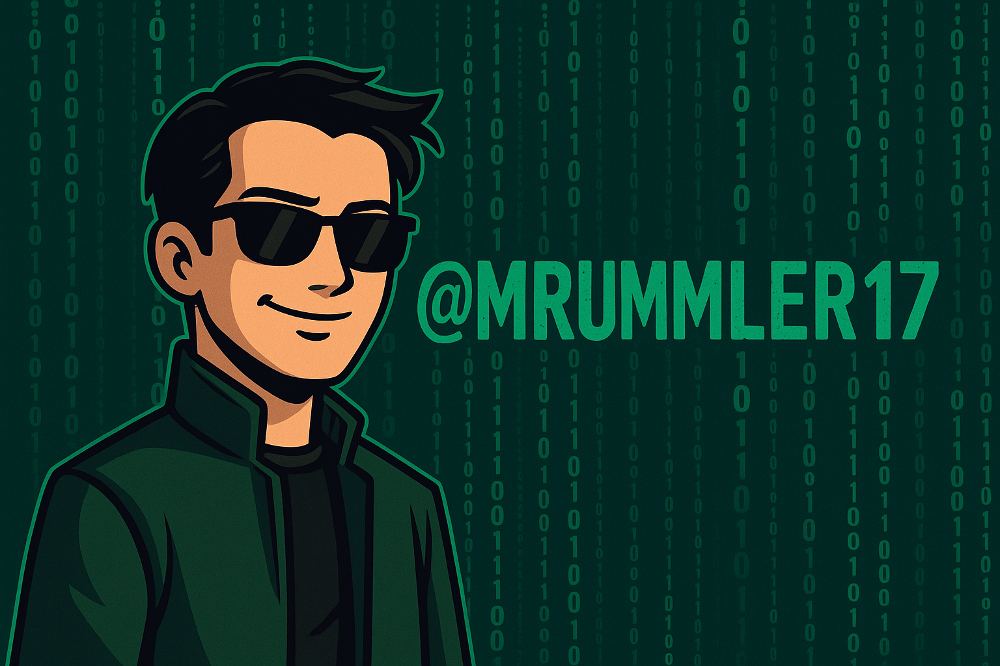

# Hi, I'm Marcus Rummler

I'm a self-taught builder creating practical digital products, automation and
AI-assisted tools. I'm interested in AI development, learning technology and
grassroots motorsport.

RETSA Group remains active, with consulting and training currently paused.
My focus is on building and maintaining useful products.

## Projects

- **[PledgeBoard](https://pledgeboard.com.au)** - Fundraising pledge boards for
  schools, clubs and community groups.
- **[TowWise](https://towwise.online)** - Route planning for towing.
- **[RETSA Group](https://retsagroup.com.au)** - My business and product hub.
- **[Project E36](https://projecte36.com.au)** - Grassroots motorsport, team news
  and sponsorship.
- **RepoMedic** - Repository hygiene, security triage and dependency maintenance.
- **AI API Proxy Guard** - Tools for safer, more controlled use of AI APIs.
- **IDA** - AI-assisted business and learning workflows.

## How I work

Start with a real problem, keep the solution simple and validate changes before
release. I care about maintainable systems, reliable workflows and responsible
use of AI.

## Contact

[training@retsagroup.com.au](mailto:training@retsagroup.com.au)
